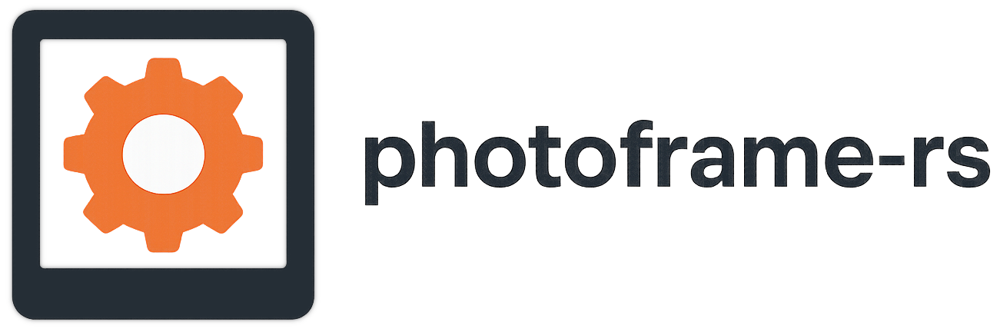
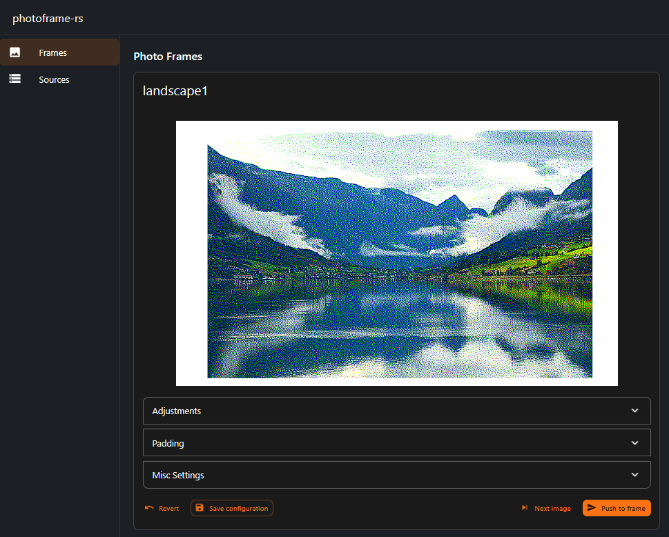

Rust-based photo frame orchestration server for networked (e.g. Spectra E6 / multi‑color e‑ink) displays.

The server periodically selects photos from configured sources, processes them, and pushes the result to networked e‑ink frames over HTTP.



---
### Quick start (server)
```bash
cp photoframe.example.toml photoframe.toml   # edit to match your devices & sources
cargo run -p photoframe-server               # binds 0.0.0.0:8080 by default
```

### Quick start (web UI)
```bash
npm install --prefix photoframe-nextjs
npm run dev --prefix photoframe-nextjs
```

### Supported dithering algorithms
Type | Identifiers
-----|------------
Diffusion | `floyd_steinberg`, `jarvis_judice_ninke`, `stucki`, `burkes`, `sierra_3`, `sierra_2`, `sierra_1`, `atkinson`, `reduced_atkinson`
Ordered / Other | `ordered_bayer_2`, `ordered_bayer_4`, `ordered_bayer_8`, `ordered_blue_256`, `stark`, `yliluoma1`, `yliluoma2`

### Sources
Kind | Config Block | Notes
-----|--------------|------
Filesystem | `[sources.<id>.filesystem]` | Glob expanded once at startup; orientation via dimensions.
Immich | `[sources.<id>.immich]` | Needs `base_url`, `api_key`; optional `filters` for [searchAssets](https://immich.app/docs/api/search-assets) request body parameters.

Immich snippet:
```toml
[sources.family]
kind = "immich"
[sources.family.immich]
base_url = "http://immich.local:2283"
api_key = "YOUR_KEY"
order = "random"
filters = { personIds = ["uuid1", "uuid2"] } # Finds photos containing both persons "uuid1" AND "uuid2"
```

Hint: You can configure multiple immich sources if you want different sets of filters (for example photos containing persons "uuid1" OR "uuid2" must be done with two separate immich sources)

### Metrics

`GET /metrics` serves Prometheus metrics, labelled by frame id or source id:

Metric | Meaning
-------|--------
`photoframe_update_attempts_total{frame,result}` | Update jobs by outcome: `success`, `push_failed` (the frame did not accept the image after all retries), `no_image`, `error`.
`photoframe_update_consecutive_failures{frame}` | Failed update jobs in a row; 0 after a success. Alert on this, e.g. `>= 2`.
`photoframe_last_update_success_timestamp_seconds{frame}` | Time of the last successful update job.
`photoframe_push_failures_total{frame,reason}` | Pushes that failed after all retries, by the last attempt's `reason`: `connect`, `timeout`, `http_status`, `request`.
`photoframe_push_attempt_failures_total{frame,reason}` | Every failed HTTP attempt, including ones that a retry recovered.
`photoframe_last_push_success_timestamp_seconds{frame}` | Time of the last image the frame accepted (including manual pushes).
`photoframe_source_errors_total{source,kind}` | Errors listing (`search`) or fetching (`fetch`) images from a source.

### Embedding the web UI in the server

By default the Rust binary embeds and serves the Next.js UI at `/` using a cargo feature `embed_ui`.

Build steps:

- Build the UI once as a static export (Next.js 14):
	- `npm install --prefix photoframe-nextjs`
	- `npm run build --prefix photoframe-nextjs` (produces `photoframe-nextjs/out`)
- Build and run the server:
	- `cargo run -p photoframe-server`

Disabling embedding (useful when running `next dev` separately):

```
cargo run -p photoframe-server --no-default-features
```
